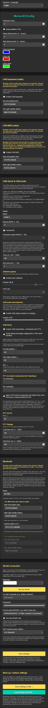

# Adapter Configuration

There is a possibility to configure this adapter via a web frontend (WiFi).
You can find some example configurations in folder  [exampleConfiguratios](../exampleConfiguratios/)  

## How the configuration page works
* Most settings take effect **immediately**, as soon as you change them (number and text fields after you leave the field).
* They are only stored permanently after you press **"Save settings"** at the bottom of the page. The button **blinks** as long as something has not been saved yet.
* A few settings need a **restart** of the adapter (WLAN, USB keyboard on/off, USB MIDI on/off, USB audio on/off, Bluetooth mode). They have their own save button, or are applied when you press "Save settings"; the adapter restarts by itself afterwards.

## WLAN
If the adapter is freshly flashed you have to find it inside your wireless environment.
Default SSID is "Morse-S3-Config", you don't need a password.
Once you are connected to the device you can reach the configuration page via web browser (e.g. Firefox..) at http://192.168.4.1

As a first step it's a good idea to connect the adapter to your home network. Therefore scroll down, click "Rescan WLAN", go to "Netze:" and select your home network. Finally enter your network password and click "WLAN speichern & neu starten" ("Save WLAN & restart").

Afterwards the adapter can also be reached in your home network via http://morse-s3.local or via the IP address assigned by your router. If the home network cannot be reached, the adapter opens its own hotspot again.

## Language
Currently you can select between "English" and "German" language. The page switches immediately.

## Paddle
* **Debounce time (ms):** Contacts of a paddle often "bounce" for a short moment. The adapter ignores changes that happen within this time. The default of 8 ms is fine for most paddles; increase it if you get double dits or dahs.
* **Swap paddles (L/R):** Swaps the "dit" and "dah" paddle if your paddle is wired the other way round (or you hold it left-handed).

## ESP32 behavior
* **Sleep timeout (min, 0 = never):** After this time without paddle activity the ESP32 goes into deep sleep to save power. Pressing the paddle wakes it up again. If more than one interface (keyboard, MIDI..) is used, sleep mode should not be activated (set it to 0).
* **Web timeout (min, 0 = never):** After this time the WiFi (and with it the configuration page) is switched off. Set it to 0 while you are configuring.
* **LED colors:** The onboard LED generates a heartbeat (blinks every second) as soon as the ESP32 has booted or left sleep mode. The color of this heartbeat can be adjusted ("Color heartbeat"). Additionally the LED turns "red"/"green" while the dot/dash key is pressed. These colors can be changed too ("Color dot", "Color dash").

## Not all USB functions at the same time
The USB interface of the ESP32-S3 has only a **limited number of endpoints** (4 usable "IN" endpoints). Every USB function needs one of them:

| Function | Endpoint |
|---|---|
| Virtual COM port (USB-Serial, always present as the base of the serial connection) | 1 |
| USB keyboard | 1 |
| USB MIDI | 1 |
| USB audio (microphone) | 1 |
| Status pins (DCD/DSR/Break, only if at least one pin is assigned) | 1 additional |

So **not everything can be active at the same time**. Activating all four USB functions and additionally assigning status pins needs more endpoints than the chip offers. Which function would then be missing has not been tested, so please do not rely on it.

Recommendation:
* Activate only what you really need (e.g. USB audio plus status pins for SDR-Console, or the USB keyboard for browser based programs).
* If status pins are not needed, leave all pins ("Dit", "Dah", "Key", "PTT") on "Off"; then the additional endpoint is not used.
* Bluetooth does not use USB endpoints and can be used independently.

## USB Keyboard
The ESP32 can emulate a USB keyboard. Default keys are "Left Ctrl" and "Right Ctrl" for "dot" and "dash".
These defaults can be used e.g. for vband, morsecode.world or "Morse Keyer" app (tested with Morse Keyer V5.3.0).

* **Enable USB keyboard:** switches the USB keyboard on or off (needs a restart).
* **Key left paddle (dot) / Key right paddle (dash):** the key that is sent when the paddle is pressed. You can choose letters, modifier keys, function keys, arrow keys and special characters. The names refer to a German (QWERTZ) keyboard layout on the receiving device.

There is no keyer inside the adapter in this mode: only "pressed" and "released" is passed on, the application on the PC creates the characters.

## USB Midi
Some applications require a USB-MIDI interface (e.g. [PaddleBridge](https://github.com/RaspCla/PaddleBridge)).
The adapter then sends real MIDI notes (in addition to the USB keyboard commands, you can use both at the same time or only one of them).

* **Enable USB MIDI:** switches USB MIDI on or off (needs a restart).
* **Note left paddle (dot) / Note right paddle (dash):** the MIDI note that is sent for each paddle (defaults 18 and 38). The note names follow the convention C4 = 60. Changes of the notes take effect immediately.

**Attention:** If USB keyboard and USB MIDI are both active, the USB drivers on the PC may hang after the adapter has gone to sleep automatically (only a PC restart helps then). In this case set the sleep timeout to 0.

## USB-Serial and USB-Audio
**Note: the USB-Audio interface and the serial status pins require the ESP32 Arduino core 3.3.13 (Espressif) or newer. No library patch is needed with that core.**

This part of the page allows a morse paddle to be connected directly to a software TRX like SDR-Console (Simon Brown). The adapter contains its own keyer that creates a morse tone, sends it to the PC as a microphone signal and switches PTT (transmit) at the right moment.

The page shows a status block at the top of this section (does the core support the status lines, is the COM port opened on the PC, DTR/RTS state, number of sent messages ...). It helps if something does not work.

### Keyer
The keyer turns the paddle contacts into correct morse characters. It is used for the USB microphone tone, the piezo sidetone and the "Key" status line.
* **Mode:** "Straight key (paddle direct)" (keyer off, the paddle works like a hand key, this is the default), "Iambic A" or "Iambic B" (squeeze keying; the two variants differ in what is sent when both paddles are released at the same time).
* **Speed (WPM, 5 - 60):** keying speed, default 20.
* **Farnsworth / Character speed:** With Farnsworth the characters are sent at the character speed (default 18 WPM), but the pauses between the characters are stretched so that the speed set above results as overall speed. This is useful for learning morse code. The stretching is recalculated automatically if you change the speed.
* **Tone (Hz, 300 - 1500):** pitch of the morse tone, default 700 Hz. It is used for the USB microphone and the piezo.
* **Rise time (ms, 1 - 20):** how soft the tone starts and stops (default 5 ms). A very short time can cause clicks, a longer time sounds softer.

### Sidetone (piezo)
As an option you can attach a piezo speaker as sidetone (low delay) to a free GPIO pin (plus to the pin, minus to GND).
* **Enable piezo sidetone**
* **Volume:** 1 - 100 %
* **GPIO pin:** pin of the piezo (default 7). Pins 19/20 (USB), 21 (LED) and the paddle pins are not allowed.

The piezo follows the keyer immediately (without the lead time described below). Its pitch is the "Tone" of the keyer. For a small loudspeaker instead of a piezo a driver/transistor may be needed.

### USB audio (microphone)
* **Enable USB audio:** switches the interface on or off (needs a restart).
* **Volume:** 1 - 100 %

You will find a new audio interface (microphone) in your device manager and sound settings. Typically it's named "Microphone (x-TinyUSB (UAC1))". It is a recording device only (mono, 48 kHz, 16 bit), there is no loudspeaker. Select it in your PC software (e.g. SDR-Console) as audio source and adjust the volume.

If PTT is active (see below), the tone is delayed by the "lead time", so the transceiver has time to switch to transmit before the tone arrives. Without PTT the tone comes immediately.

### USB-Serial
* **Enable USB serial (lines, commands and PTT):** the adapter appears as a virtual COM port on the PC. Over this port it can signal PTT to the PC software. No baud rate has to be set, any value is fine in your terminal program.
* **Serial debug messages:** diagnostic messages in a serial monitor. Debug output and USB serial share the same COM port, so only one of them can be active: if you switch one on, the other is switched off.

Depending on your software you can use one or both of the following PTT methods.

#### PTT via Serial Commands (CAT interface)
At the start and end of sending the adapter sends a text over the COM port, e.g. "TX;" and "RX;" (defaults). You can change both texts. `\r` and `\n` stand for line ends, an empty text sends nothing.
* **Ignore DTR:** Some programs (e.g. SDR-Console) open the COM port without setting the DTR line. Without this option the adapter would send nothing to them. It is switched on by default.

#### PTT via Pin (status lines)
The adapter can also set the modem status lines of the virtual COM port. Your PC software can read them like pins (e.g. as PTT input). For each of the following signals you can choose "Off", "DCD", "DSR" or "Break":
* **Dit (left paddle) / Dah (right paddle):** the raw paddle contacts (no keyer involved). Defaults: Dit = DCD, Dah = DSR.
* **Key:** the finished morse signal from the keyer, delayed by the lead time.
* **PTT:** switches on immediately when a paddle is pressed and stays on for the hold time after release.

In your PC software the matching input (DSR or DCD) has to be selected. CTS is not possible over USB. Not assigned lines do not use anything.

Please take into account, the serial pins (DSR/DCD) require ESP32 core 3.3.13 or later (the USB-Audio interface as well). The status lines need one additional USB endpoint, which is only created if at least one status pin is assigned. See "Not all USB functions at the same time" above.

**Ignore DTR (important for status pins):** Without this option the status pins are only available while the PC application has the COM port open with DTR set. With the option they are always available. Programs that do not set DTR (such as SDR-Console) need it.

#### PTT timings
These two values apply to both PTT methods:
* **Lead time (ms, 0 - 1000):** time between PTT and tone. PTT comes immediately, tone and "Key" line follow after the lead time (default 150 ms), so the transceiver is ready.
* **Hold time (ms, 0 - 5000):** after the paddle is released PTT stays active for the hold time (plus the lead time, because the tone ends delayed by that time). Default 300 ms.

## Bluetooth
The adapter can also connect to a phone or tablet via Bluetooth Low Energy (e.g. Morse-It on the iPhone). Choose the **mode** and save:
* **BLE keyboard:** the adapter shows up as a Bluetooth keyboard ("Morse-Paddle-KBD") and sends a key for each paddle (default Left/Right Ctrl).
* **BLE MIDI:** the adapter shows up as a Bluetooth MIDI device ("Morse-Paddle-MIDI") and sends notes (defaults 18 and 38) plus an optional volume value (MIDI CC7, default 127; not every app reacts to it).
* **BLE off:** Bluetooth is switched off.

The notes and keys below the mode selection only apply to the matching mode (the other area is greyed out) and are saved separately. The page shows the Bluetooth address of the adapter.

Please note:
* BLE MIDI and BLE keyboard do not work at the same time, and only one device can be connected at a time (whoever connects first).
* Both modes require pairing. Afterwards supported devices (e.g. iOS 16+ / macOS 13+) reconnect automatically when the adapter is switched on. Whether the app uses this depends on the app.
* In MIDI mode the adapter uses its own Bluetooth address, so that a device that was once paired as keyboard does not connect by mistake. WLAN address and IP stay unchanged.
* The Bluetooth settings are independent from the USB settings.

## Saving the settings
Press **"Save settings"** to store everything permanently (see "How the configuration page works"). The adapter restarts only if a setting was changed that needs a restart.

## Back up / restore settings
At the bottom of the page you can save all settings into a text file and load them again, e.g. to copy the configuration to a second adapter or to keep a backup.
* **Save settings to file:** a small window opens. Enter a **file name** (suggestion: `morse-s3-settings_date_time.txt`, so nothing is overwritten). Optionally tick **"Include WiFi credentials (password encrypted)"** and enter a **file password**: your home network name and password are then stored in the file, encrypted with this password (AES-256). The file password has to be entered again when loading. Choose a decent password.
* **Load settings from file:** choose the file. The values are only taken over into the page (like typed in by hand, the "Save settings" button blinks), they are stored permanently when you press **"Save settings"**. Missing entries do not change anything, unknown entries are ignored.

The file is a readable text file (lines `name = value`, comments start with `#`) and may be edited by hand.

Where the file goes depends on your browser: Chrome and Edge can show a normal file dialog and remember the last folder, but only on a "secure" page. Because the adapter page is `http://192.168.x.x` this has to be allowed once in `chrome://flags/#unsafely-treat-insecure-origin-as-secure` (Edge: `edge://flags/...`). Otherwise (and in Firefox) the file is downloaded into your download folder.

 
 
 
[← back to table of contents](README.md)
