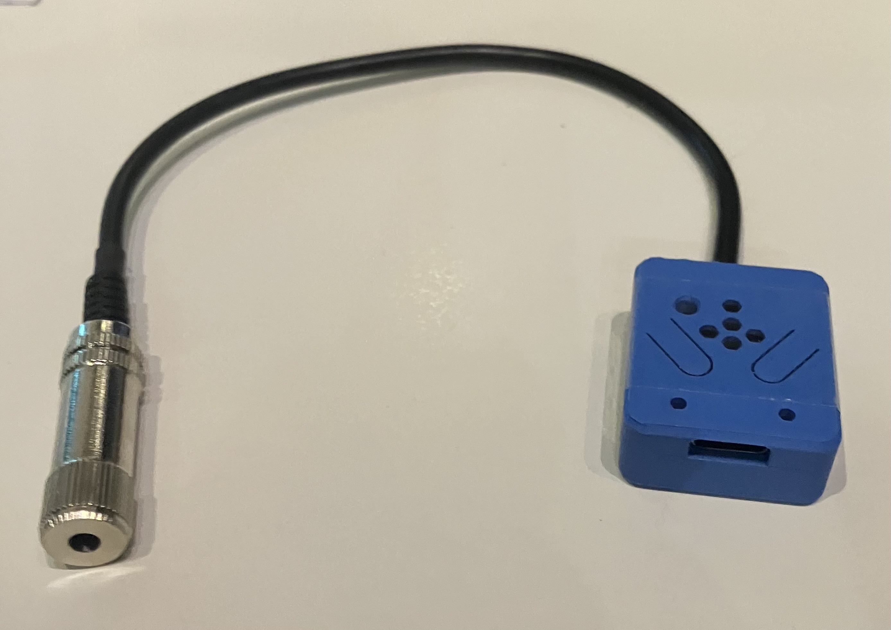
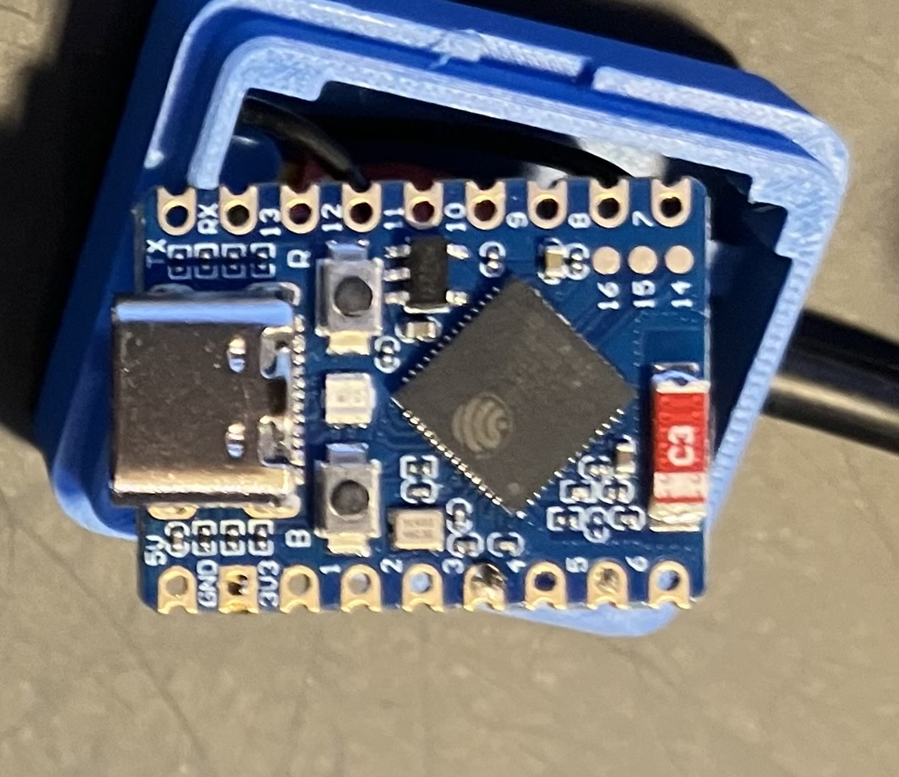
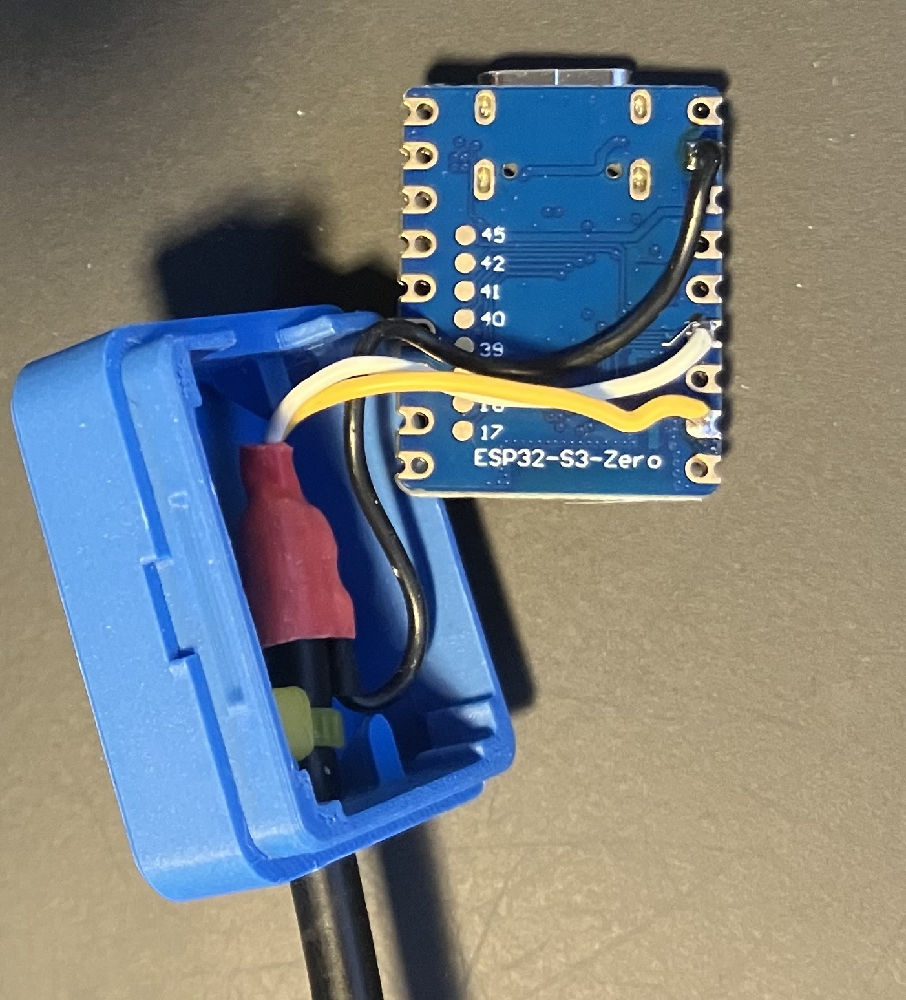
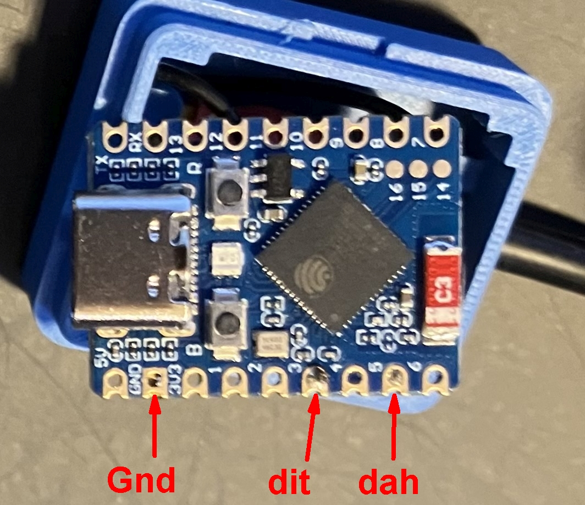

# Hardware-Dokumentation
The hardware is based on an ESP32-S3-Zero/-Mini.
It is important that you use a ESP32-S3 or similar ESP type which supports a native USB interface e.g. USB keyboard.
Using an ESP with standard USB2Serial converter will not work.

## Some pictures

   

[← back to table of contents](README.md)
